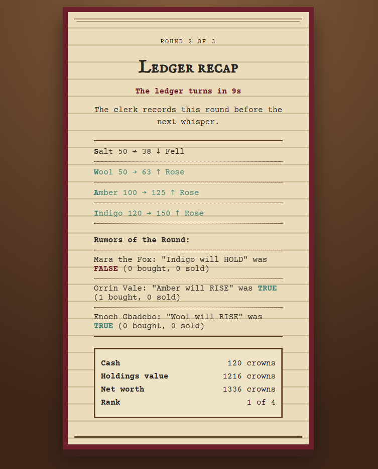

# Guildhall Whispers: A Game of Rumors and Trade — Submission

Entry for the Handshake AI Skills Studio "Create a Multiplayer Game" mission (OpenAI). Deadline: **Oct 30, 2026, 11:59 PM PT**.

The entry form asks for four things: title, cover image, description and link. Each is below, ready to paste.

---

## a. Project title

```
Guildhall Whispers: A Game of Rumors and Trade
```

## b. Project cover image




## c. Project description

**Short version** (use this if the form limits length):

```
Play alone right now: tap Play with bots and bot merchants take the other seats. Guildhall Whispers is a hidden-information trading game for 3-8 merchants in a medieval guildhall. Each round you get one private whisper about where a price is headed, but whispers are only right about 70% of the time. Pass rumors to the board honestly or dishonestly, then buy and sell four goods before the prices turn. Richest purse wins. Join from any phone with a four-letter code: no login, no install.
```

**Full version:**

```
Play alone right now: enter a name, tap Play with bots, and bot merchants take the other seats at your table.

Guildhall Whispers is a hidden-information trading game for 3-8 players, set in a medieval guildhall. Merchants trade four goods: Salt, Wool, Amber and Indigo. Each round, every merchant receives one private whisper about where a price is headed. A whisper is only true about 70% of the time, so nobody can fully trust their own information.

Each merchant may post one rumor per round to a public board, honestly or not, using simple pickers for a good and a direction. Then everyone stages buy and sell orders and seals them before the market turns. Prices rise 25%, fall 25% or hold, and the reveal shows the true change and which rumors were false.

Everyone starts with 1,000 fictional crowns. The highest net worth after the final round wins, with ties broken by cash. A game runs 3 or 5 rounds, about 10 to 12 minutes for five.

Why it matters: it turns information asymmetry, risk and trust into a game anyone can pick up. It works for board-game nights and for classes exploring how rumors move markets. There is no real money and there are no real tickers.

Details:
• Join from any phone or laptop with a four-letter code. No login, no install.
• All randomness and all math run on the server. Whispers go privately to each player, and the true outcomes stay hidden until the market turns.
• Orders are staged and sealed as a batch, and resealing replaces the earlier batch until the timer ends.
• A first-run tutorial explains the rules in four cards.
• Rejoin after a dropped connection, and if the host leaves the role passes on.
• Badges for the most honest broker and the smoothest liar.
```

## d. Project link

```
https://guildhall-wyta.onrender.com/
```

Source: https://github.com/DatomCode/Guildhall

---

## Quick start for a judge (about 3 minutes)

1. Open the link, type a merchant name, tap **Play with bots**.
2. Whisper: tap the folded note to unfold it. It names one good and a direction, and it is wrong about 30% of the time, so treat it as a hint.
3. Trade: use the plus and minus steppers to stage buys and sells (up to 15 units per good, no debt). Optionally post one rumor with the good and direction pickers, true or not. Then tap **Seal Orders** before the timer ends.
4. Market turns: watch each price flip, then read the ledger for your net worth, your rank, and which rumors were false.
5. Play through the remaining rounds. Highest net worth wins, and ties go to the merchant with more cash.

## Before you submit

- [ ] Check eligibility in the official rules. You must be 18 or older, a legal resident of a country on the eligible list, and have an active Handshake account with the email you enter. Nigeria is not on that list.
- [ ] Open the live link. If it takes a while the first time, the free instance was asleep. Set up an UptimeRobot ping every 10 minutes so judges never hit a cold start.
- [ ] Play one full game with bots on the live link, on a phone and on a laptop.
- [ ] Play one full game with 3 real players on separate devices.
- [ ] Check every bullet under Details in the full description against the live build, and delete any that are not there.
- [ ] Confirm the entry was built with the OpenAI "Create a Multiplayer Game" mission in Handshake, and be ready to explain how you built it.
- [ ] Paste the title, upload the cover, paste the description (short or full), paste the link.
- [ ] Submit by Oct 29, not on the last day. The deadline is Oct 30, 11:59 PM PT, which is 7:59 AM on Oct 31 in Lagos.